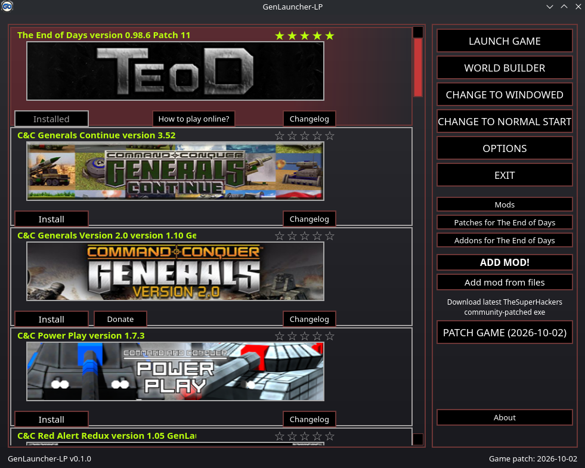
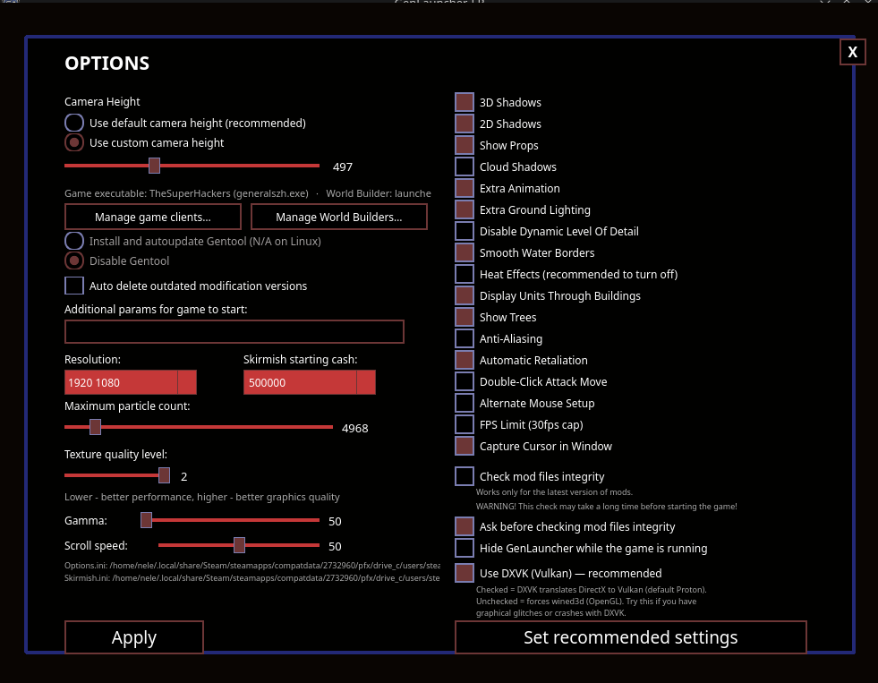
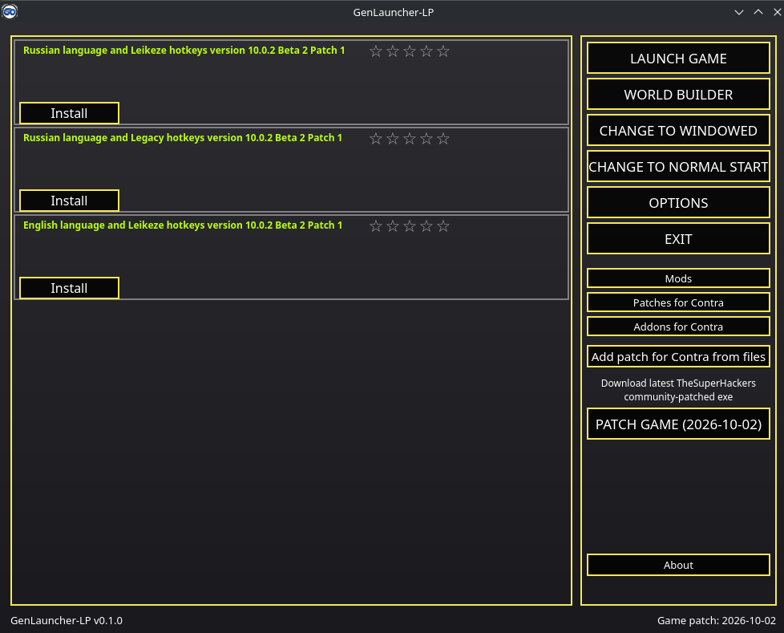
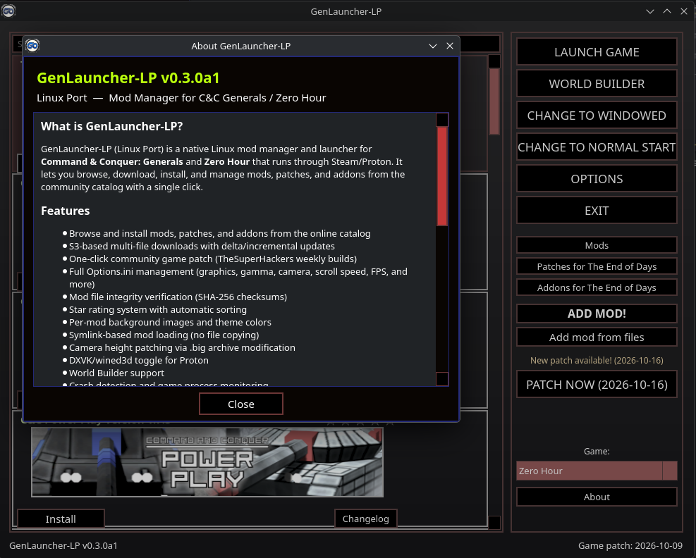

# GenLauncher-LP

[](https://github.com/NeleBiH/GenLauncher-LP/releases)
[](LICENSE)
[](https://www.python.org)
[](https://github.com/NeleBiH/GenLauncher-LP)

**Native Linux mod manager for Command & Conquer: Generals and Zero Hour.**

> **Alpha software** — this project is in early testing. Bugs are expected.
> Use at your own risk. I am not responsible for any issues, data loss,
> or damage to your game installation.
> If you encounter a problem, please [open an issue](https://github.com/NeleBiH/GenLauncher-LP/issues).

Runs the game through Steam/Proton — no Windows needed. Browse, download, install,
and manage mods from the community catalog with a single click.

A native Linux application written in Python + PySide6 — the launcher itself runs
directly on your system, no Wine needed. Based on the GPL-3.0 GenLauncher Rewritten project.

## Screenshots

| Main Window | Options |
|:-----------:|:-------:|
|  |  |

| Patch Game | About |
|:----------:|:-----:|
|  |  |

## Features

- **Mod catalog** — browse and install mods, patches, and addons from the online community catalog
- **S3 downloads** — multi-file downloads with delta/incremental updates
- **One-click game patch** — download latest TheSuperHackers community-patched exe directly
- **Options.ini editor** — resolution, gamma, camera height, scroll speed, FPS cap, texture quality, anti-aliasing, and more
- **Mod integrity check** — verify installed mod files via SHA-256 checksums
- **Star rating system** — rate your mods, higher rated mods sort to the top
- **Per-mod themes** — custom background images and theme colors per mod
- **Symlink-based loading** — mods are linked into the game folder, no file copying, fully reversible
- **Camera height patching** — modify camera zoom via .big archive editing
- **DXVK / wined3d toggle** — switch between Vulkan and OpenGL renderers in Proton
- **World Builder** — launch the Zero Hour map editor through Proton
- **Crash detection** — detects if the game crashes (exits within 12 seconds)
- **Game process detection** — prevents launching a second game instance
- **Mod search** — filter mods by name with instant partial matching
- **Game selector** — switch between Generals and Zero Hour on the fly, catalog reloads automatically
- **Auto patch check** — background version check shows patch status (green = up to date, yellow = update available)
- **Custom link overrides** — fix broken catalog download URLs locally

## Requirements

- Linux with Steam and Proton
- Python 3.12+
- A licensed copy of C&C Generals or Zero Hour on Steam
- `unrar` for .rar mod archives (optional)

## Quick Install

```bash
curl -fsSL https://raw.githubusercontent.com/NeleBiH/GenLauncher-LP/main/setup_genlauncher_LP.sh -o setup.sh
chmod +x setup.sh
./setup.sh
```

The setup script provides an interactive menu:

```
  1)  Install
  2)  Update
  3)  Uninstall
  4)  Run GenLauncher-LP
  5)  Exit
```

## Run Without Install

```bash
git clone https://github.com/NeleBiH/GenLauncher-LP.git
cd GenLauncher-LP
./run.sh
```

`run.sh` automatically creates the virtual environment and installs all
Python packages on first run — no manual setup needed.

## Usage

```bash
./run.sh                 # graphical interface
./run.sh cli detect      # find game install, Steam app id, Proton builds
./run.sh cli list        # list the mod catalog
./run.sh cli install "NAME"  # download and install a mod
./run.sh cli link "NAME"     # link mod into the game folder
./run.sh cli unlink          # remove links, restore originals
./run.sh cli status          # show what is installed
```

## How Mod Linking Works

Linking never overwrites or deletes a game file. Each file a mod provides is
moved aside to `<name>.GLR` and replaced with a symlink into the mod folder.
`unlink` puts everything back. If interrupted, `cleanup` restores the folder
automatically.

## Where Files Live

| What | Path |
|---|---|
| Config | `~/.config/genlauncher/` |
| Mod store | `~/.local/share/genlauncher/mods/` |
| Download cache | `~/.local/share/genlauncher/cache/` |
| Link journal | `~/.local/share/genlauncher/links.json` |
| Logs | `~/.local/state/genlauncher/` |

The game directory is only modified while mods are linked.

## Credits

**Created by Nele** with the help of **Claude** (Anthropic) and open-source code.

### Special Thanks

- **[GenLauncher Rewritten](https://github.com/GenLauncherRewritten/GenLauncherRewritten)** — the original mod catalog, S3 infrastructure, and community ecosystem
- **[TheSuperHackers](https://github.com/TheSuperHackers)** — community game patches and the [GeneralsGameCode](https://github.com/TheSuperHackers/GeneralsGameCode) project
- **Electronic Arts** — for [open-sourcing](https://github.com/electronicarts/CnC_Generals_Zero_Hour) Generals and Zero Hour under GPL-3.0
- **[PySide6](https://www.qt.io/qt-for-python)** — Qt for Python, powering the entire UI

## License

GPL-3.0 — Free and open source software.
